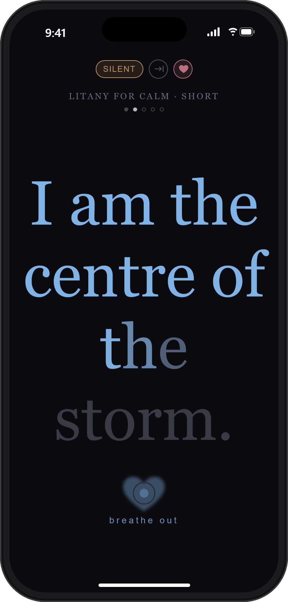
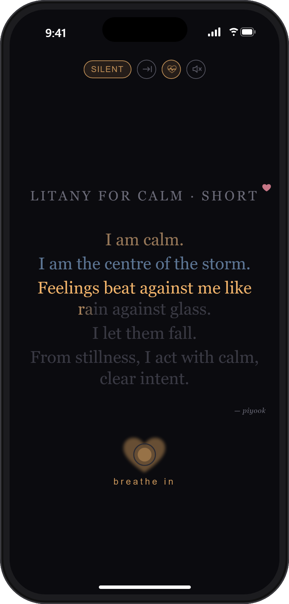

# Litany Reader

[](https://github.com/piyook/Litany-Reader/releases)
[](LICENSE)
[](https://nodejs.org/)
[](package.json)
[](#docker)

A very simple app that shows a litany one line at a time, in large text, paced to guide calm breathing. You can also see the whole litany on one screen if you prefer, or read a three-line short form when you only have a moment. An optional [heartbeat](#heartbeat), seen and heard, slows as you read to help you settle.

| One line at a time | Whole litany |
|---|---|
|  |  |

The idea comes from the **Litany Against Fear** in Frank Herbert's *Dune* (1965), recited by the Bene Gesserit to calm the mind in the face of fear. The litanies here are written in the same spirit: short lines, spoken slowly, in time with the breath.

A litany takes practice before it works in real situations. This tool helps by linking your breathing to the litany you are reading, so you can focus on the meaning of each line. Reading it the same way, at the same pace, again and again also helps you learn it by heart, so it is there when you need it without the screen.

**Use it online at https://piyook.github.io/Litany-Reader/**, or install it as an app on your phone, tablet or computer: see [Install as an app](#install-as-an-app).

Add your own as `.txt` files in the `litanies` folder (see [File format](#file-format)).

These help me. I hope they help someone else.

> [!NOTE]
> This is a calming aid, not a substitute for professional help. If you are struggling, please reach out to someone: a friend, your doctor, or a helpline. You are not alone.
>
> - Anywhere: [Find A Helpline](https://findahelpline.com) lists free, confidential helplines in your country.
> - UK and Ireland: [Samaritans](https://www.samaritans.org), call 116 123, free, any time.
> - US: [988 Suicide & Crisis Lifeline](https://988lifeline.org), call or text 988.
>
> If you are in immediate danger, call your local emergency number.

## Install as an app

<p align="center">
  
  &nbsp;&nbsp;
  
</p>

The reader is online at **https://piyook.github.io/Litany-Reader/**. You can use it in the browser as it is, or install it as an app on a computer, phone or tablet. Installed, it has its own icon, opens in its own window with no address bar or browser toolbars, and works with no internet connection: every litany is saved on the device the first time it opens.

Nothing is downloaded from an app store, and there is no account. It updates itself when you open it while online.

### Android phone or tablet

Use **Chrome** (or Samsung Internet or Edge).

1. Open https://piyook.github.io/Litany-Reader/ in Chrome.
2. Tap the **⋮** menu (top right).
3. Tap **Install app**. If you only see **Add to Home screen**, tap that, then choose **Install**.
4. Open it from the new **Litanies** icon on your home screen or in your app list.

Samsung Internet: tap the **≡** menu, then **Add page to**, then **Home screen**.

> [!IMPORTANT]
> Some browsers, such as **DuckDuckGo**, can only add a bookmark to the home screen. That opens the site inside the browser, with its address bar and toolbars, not as an app. If that happens, remove the icon (press and hold it, then **Remove**) and install from Chrome instead. Your default browser can stay as it is.

### iPhone or iPad

Use **Safari** (Chrome and Edge on iPhone also work, from their own Share button).

1. Open https://piyook.github.io/Litany-Reader/ in Safari.
2. Tap the **Share** button (the square with an arrow pointing up). On iPhone it is at the bottom of the screen; on iPad, at the top.
3. Scroll down and tap **Add to Home Screen**. If you see an **Open as Web App** switch, leave it on.
4. Tap **Add**, then open it from the new **Litanies** icon.

### Windows, Mac, Linux or Chromebook

Use **Chrome** or **Edge**.

1. Open https://piyook.github.io/Litany-Reader/.
2. Click the **install** icon at the right-hand end of the address bar (a small screen with a down arrow), then **Install**.
   - If there is no icon in Chrome: **⋮** menu, then **Cast, save and share**, then **Install page as app**.
   - If there is no icon in Edge: **⋯** menu, then **Apps**, then **Install this site as an app**.
3. It opens in its own window and is added to your Start menu, Dock or app launcher. You can pin it to the taskbar like any other app.

Safari on a Mac (macOS Sonoma or later): **File** menu, then **Add to Dock**.

Firefox on the desktop does not install web apps, so use Chrome or Edge for this.

### Good to know

- **Controls:** tap or click the screen to show them; they hide again after a few seconds.
- **Favourites and settings** are kept by the browser you installed from. If you used the site in a different browser before, set them again in the app.
- **Removing it:** on a phone or tablet, press and hold the icon, then **Uninstall** or **Remove**. On a computer, open the app, click the **⋮** or **⋯** menu in its title bar, then **Uninstall**.
- The online copy has only the litanies in this repository, not ones you add to your own `litanies` folder. To use your own, run it on your computer as below.

## Run

```
npm start    # runs in the background and opens your browser
npm stop     # stops it
```

Or double-click `start.bat` and `stop.bat`. The reader is at http://localhost:8484. It needs Node.js; there is nothing to install.

The online copy is published from this repository by GitHub Pages each time `main` changes. To build the same static copy yourself: `npm run build` writes it to `dist/`.

### Docker

```
npm run docker:start   # builds the image, starts the container and opens your browser
npm run docker:stop    # stops and removes the container
npm run docker:logs    # follow the server log
```

Or without npm: `docker compose up -d --build` and `docker compose down`.

The container restarts by itself whenever Docker starts, until you stop it with `docker:stop`. The `litanies` folder is read from your project folder, so new or edited files show up on refresh without a rebuild. Run either the local server or the container, not both, as they use the same port.

### Port

The port is 8484 unless you set another in a `.env` file in the project folder (copy `.env.example`):

```
PORT=9000
```

This applies to `npm start` and to Docker.

## Litanies

| File | Author |
|---|---|
| `litany-against-anxiety.txt` | piyook |
| `litany-against-despair.txt` | piyook |
| `litany-against-fear.txt` | piyook |
| `litany-against-overwhelm.txt` | piyook |
| `litany-against-regret.txt` | piyook |
| `litany-against-self-criticism.txt` | piyook |
| `litany-against-social-anxiety.txt` | piyook |
| `litany-against-worry.txt` | piyook |
| `litany-for-calm.txt` | piyook |
| `litany-for-determination.txt` | piyook |
| `litany-for-patience.txt` | piyook |
| `litany-for-resilience.txt` | piyook |
| `litany-for-sleep.txt` | piyook |
| `litany-of-gratitude.txt` | piyook |

Each one also has a short form of a few lines, for when you only have a moment.

### File format

Each litany is a plain `.txt` file in `litanies/`:

```
Title of the litany

First line.
Second line.
...

Short version

First line of the short form.
...

Author: Name
```

- The first line is the title.
- Every other non-empty line is one step on screen.
- The app gives each step the opposite breath to the one before, starting with an in-breath, so "I draw breath…" should be an odd-numbered step and "I release it…" an even one. Every time through starts on an in-breath, even when it repeats. If the last step falls on an in-breath (an odd number of steps), the app adds one more out-breath and hold with the last line still showing, so the litany always ends breathing out. A step is one line as it is read: with [Split to fit a breath](#settings) on, a line over the word limit counts as two or more (a line of 13 or more words with a comma or full stop in it will split at the default of 12).
- An optional `Short version` (or `Short form`) line starts a short form: the lines after it are a quick version of the litany, read when [Short form](#views) is on. A litany without one is always read in full.
- An optional `Author:` line, last in the file or last before `Short version`, is a credit, not a step. A line ending in `.`, `!` or `?` is always read as a step. It shows under the text in the whole-litany view, and as a small tag on the index when the litanies are not all by the same author.
- The title decides where the litany sits on the index: "Litany against …" under **Holding steady**, "Litany for …" or "Litany of …" under **Every day**, anything else under **More**. See [The index](#the-index).

The folder is read fresh each time, so new or edited files show up when you refresh.

## The index

The index lists your **Favourites** first, then **All litanies** in two groups:

- **Holding steady**: the litanies against something (anxiety, fear, worry…).
- **Every day**: the litanies for or of something (calm, patience, sleep, gratitude…).

Each litany shows the key word of its title large ("Fear"), with "Litany against" small above it and its opening line underneath. The groups start folded, showing how many litanies they hold and what they are; tap a group's heading to open or close it. The browser remembers which groups you opened. Favourites are always open.

## Breathing

Lines alternate between an in-breath and an out-breath:

1. **In-breath** (4s): the line fills left to right in amber.
2. **Hold** (4s): a green ring under the line draws itself round.
3. **Out-breath** (6s): the next line fills in blue, more slowly.
4. **Hold** (2s): the green ring again.

The hold ring is the same green for both holds, so a hold always looks different from breathing in or out.

This suits reading silently. You can't speak while breathing in, so for reading out loud turn on **Read aloud** (the speech-bubble button, or `A`). Each line then gets a whole breath:

1. **In-breath**: the line brightens softly. Read it silently.
2. **Hold**: the green ring.
3. **Out-breath**: the line fills in blue. Say it aloud (the cue reads *speak*).
4. **Hold**: the green ring, then the next line.

A litany takes about twice as long this way. A pill at the top of the screen shows the mode, **Silent** (amber) or **Spoken** (blue), and switches it when clicked. The setting is saved in the browser.

Next to the pill is the repeat button. It shows an arrow running into a line when the litany will be read once, and the repeat arrows (in amber) when it will loop. Click it to switch. It is the same setting as the loop button and the `L` key.

Change the timings with the ⚙ button. They are saved in the browser, and *Reset* puts them back to 4 / 4 / 6 / 2. Click anywhere outside the panel to close it.

### Long lines

A calm spoken pace is about two words a second, so a long line may not fit in one breath. In the ⚙ settings, under **Long lines**:

- **Split to fit a breath** (off by default): a line with more words than the limit is broken into parts, and each part gets its own breath. It breaks at the most natural pause nearest the middle: a full stop first, then a semicolon or colon, then a comma. A line with no such pause is left whole, and no part is shorter than three words.
- **Max words per breath** (default 12): the limit. Lower it to split more lines.

The files are not changed. In the whole-litany view each line still appears as written, and only the part being read lights up. Both settings are saved in the browser.

## Views

- **One line at a time** (the default): each line fills the screen, as large as it fits, with the litany's title small at the top. Under the title is a row of dots, one for each line: they fill as you go, so you can see how long the litany is and how far through you are.
- **Whole litany** (the lines button, or `V`): the title, every line and the author credit on one screen. Lines already read keep a softer version of their breath colour, and lines to come stay dim. Click any line to jump to it.
- **Short form** (the fold button, two arrows pressing in on a line, or `S`): reads the litany's short version instead, starting from its first line. The title shows *· short* while it is on. The setting is saved in the browser and applies to every litany that has a short form; the button is greyed out for one that doesn't.

When a litany has been read once through, the breath ring and cue give way to a **Return to index** link. On a phone the link sits above the last line instead, where the toolbar can't cover it. With repeat on it never finishes, so the link doesn't appear.

While a litany plays, the screen is kept awake so it doesn't dim or lock part way through. When you pause, it can sleep as normal.

## Learn by heart

Turn it on with the gaps button (three lines with gaps in them) or `M`. Some of the words are hidden: each shows as a blank line the width of the word. Say them from memory as you breathe the line; in the hold they fade back in, so you can check yourself. In read-aloud mode they come back in the hold after you speak the line.

Each time you read the litany through, more words are hidden: a quarter, then half, then three quarters, then all of them. A green pill at the top shows the level, for example **Hide 50%**; click it to choose another. The level is kept for each litany (and its short form separately), and the same words are hidden each time, so you are learning the same gaps. In the whole-litany view, lines you have read stay revealed and lines to come stay hidden.

## Heartbeat

An optional calming cue alongside the breath: a soft heart behind the breath ring that fades in and out like a heartbeat, with a quiet "lub-dub" sound if you want it. It starts at about the pace of a resting heart and slows as you read, and keeps slowing if you repeat the litany. Watching or listening to a rhythm that gradually slows gives you something steady to settle into. It is a calming cue, not a measure of your own pulse.

### Using it to calm down

1. Open a litany and turn on **Repeat** (the button at the top, or `L`), so it keeps going for as long as you need.
2. Turn on the heart with the heartbeat button at the top of the screen (a heart with a pulse line through it), or `B`.
3. For sound too, click the speaker button beside it. It shows a crossed-out speaker while muted. It should be a soft thump you can just hear: set it with **Heartbeat volume** in the ⚙ settings and the phone's volume buttons. It plays like any other media, so on an iPhone or iPad it plays even with the silent switch on; use the speaker button to mute it.
4. Breathe with the ring and the line, and let the heartbeat sit in the background. Don't try to match it; just notice it slowing.
5. Stay for several times through. The first time through it eases from about 60 beats a minute to about 43; then about 33, then 27, and on down toward 20.
6. When you feel settled, pause (`Space`) or close the litany. Opening a litany starts the heartbeat fresh.

On a phone, the sound plays through earphones or the speaker; with earphones it is easier to hear at a low volume. If the screen locks, the litany and the sound stop, so the app keeps the screen awake while a litany plays.

### Settings

All under **Calming** in the ⚙ settings, off by default and saved in the browser:

- **Heartbeat**: the heart behind the breath ring. Also the heartbeat buttons at the top of the screen and in the toolbar, and `B`. It fades smoothly in and out with each beat, in the breath colour, with no flash or sudden change. With *reduce motion* turned on in your device settings, the heart stays still.
- **Heartbeat sound**: a soft "lub-dub" on each beat, made by the browser (no sound file, so it works offline). It can be on with or without the heart. The speaker button at the top of the screen turns it on and mutes it. Browsers only allow sound after you tap or press a key, so it starts from your first tap after the page opens.
- **Heartbeat volume** (default 70): how loud the beat is, on a slider. When you let go of it, one beat plays at the new level. A phone's small speaker can't play the deepest part of the thump, so you may want it higher on a phone than on headphones.
- **Start heart rate** (default 60) and **Slowest heart rate** (default 20), in beats a minute, each between 10 and 150. A change takes effect straight away, the beat gliding to the new rate. Lower the start rate if 60 feels too quick to begin with.

The beat never speeds up while a litany is open: going back a line or switching between the long and short form keeps the rate where it is.

## Favourites

You can keep up to three favourites. On the index, tap the heart on the right of a litany; in the reader, use the heart button or `H`. Favourites show a filled heart and are listed under **Favourites** at the top of the index, as well as in their own group. While you read a favourite, a small rose heart shows after its title, just so you can see it is one; to remove it, use the heart button or `H`. To pick a fourth, remove one first. They are kept in a cookie in your browser.

## Controls

Move the pointer to the bottom of the screen to show the controls: previous, play/pause, next, favourite, loop, short form, learn by heart, heartbeat, whole litany, read aloud, theme, settings, back. They hide again when the pointer moves away, and the cursor hides after a few seconds without movement. The theme button (a palette) is also on the index page. It opens a list of six colour themes: Dusk (the default, dark), Dawn (light), Midnight, Forest, Parchment and Ember. Pick one and the whole app changes colour at once. Until you choose, the app starts on Dawn if your system is set to light, and Dusk otherwise. Loop can also be switched with the repeat button at the top of the screen. With loop on, the litany repeats from the start indefinitely. Turning loop on after a litany has finished starts it again.

Keys: `Space` play/pause · `←` `→` previous/next · `H` favourite on/off · `L` loop on/off · `S` short form on/off · `M` learn by heart on/off · `B` heartbeat on/off · `V` whole litany on one screen · `A` read aloud on/off · `T` choose a theme (then `↑` `↓` and `Enter`) · `F` fullscreen · `Esc` close settings, leave fullscreen, or go back to the index.

## Files

```
server.js          the server: serves public/ and reads litanies/ on each request
public/            the reader page (index.html, app.js, style.css), offline helper (sw.js), app icons
litanies/          the litany .txt files
scripts/           npm start / stop / docker helpers, litany parsing, the static build
.github/workflows/ publishes the static build to GitHub Pages
docs/              screenshots for this README
```

Settings (timings, mode, view, loop, short form, theme, long lines, learn-by-heart levels, favourites) are stored in your browser, not on the server.

## License

[MIT](LICENSE), for the code and the litanies.
