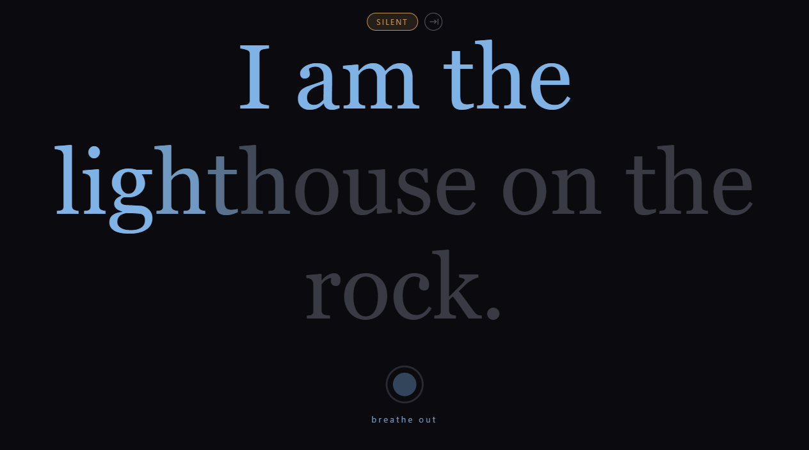
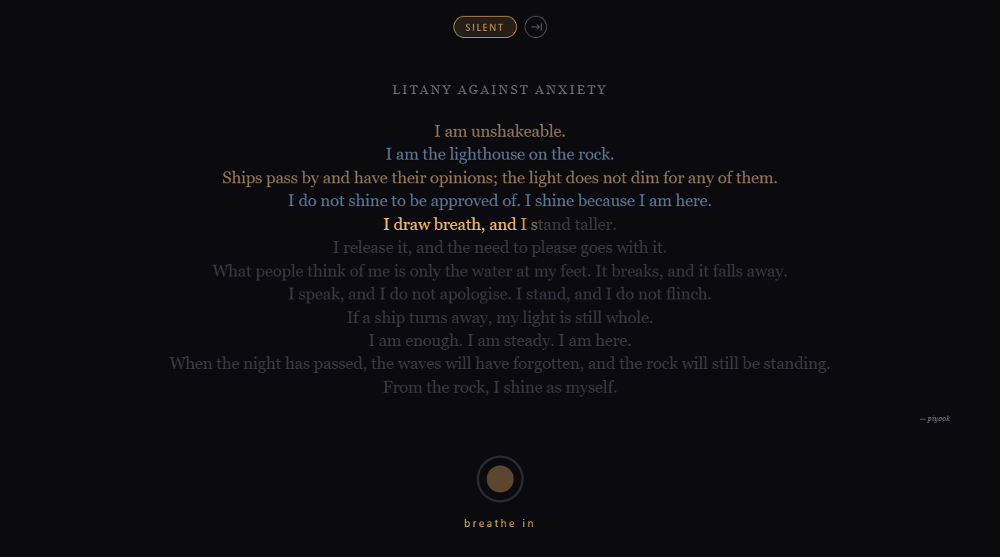

# Litany Reader

A very simple app that shows a litany one line at a time, in large text, paced to guide calm breathing. You can also see the whole litany on one screen if you prefer.

| One line at a time | Whole litany |
|---|---|
|  |  |

The idea comes from the **Litany Against Fear** in Frank Herbert's *Dune* (1965), recited by the Bene Gesserit to calm the mind in the face of fear. The litanies here are written in the same spirit: short lines, spoken slowly, in time with the breath.

A litany takes practice before it works in real situations. This tool helps by linking your breathing to the litany you are reading, so you can focus on the meaning of each line.

Add your own as `.txt` files in the `litanies` folder (see [File format](#file-format)).

These help me. I hope they help someone else.

## Run

```
npm start    # runs in the background and opens your browser
npm stop     # stops it
```

Or double-click `start.bat` and `stop.bat`. The reader is at http://localhost:8484. It needs Node.js; there is nothing to install.

### Docker

```
npm run docker:start   # builds the image, starts the container and opens your browser
npm run docker:stop    # stops and removes the container
npm run docker:logs    # follow the server log
```

Or without npm: `docker compose up -d --build` and `docker compose down`.

The container restarts by itself whenever Docker starts, until you stop it with `docker:stop`. The `litanies` folder is read from your project folder, so new or edited files show up on refresh without a rebuild. Run either the local server or the container, not both, as they use the same port.

### Port

The port is 8484 unless you set another in a `.env` file in the project folder (copy `.env.example`):

```
PORT=9000
```

This applies to `npm start` and to Docker.

## Litanies

| File | Author |
|---|---|
| `litany-against-anxiety.txt` | piyook |
| `litany-against-despair.txt` | piyook |
| `litany-for-calm.txt` | piyook |
| `litany-for-patience.txt` | piyook |

### File format

Each litany is a plain `.txt` file in `litanies/`:

```
Title of the litany

First line.
Second line.
...

Author: Name
```

- The first line is the title.
- Every other non-empty line is one step on screen.
- An optional last line starting `Author:` is a credit, not a step. It shows as a small tag beside the title on the index, and under the text in the whole-litany view.

The folder is read fresh each time, so new or edited files show up when you refresh.

## Breathing

Lines alternate between an in-breath and an out-breath:

1. **In-breath** (4s): the line fills left to right in amber.
2. **Hold** (4s): a green ring under the line draws itself round.
3. **Out-breath** (6s): the next line fills in blue, more slowly.
4. **Hold** (2s): the green ring again.

The hold ring is the same green for both holds, so a hold always looks different from breathing in or out.

This suits reading silently. You can't speak while breathing in, so for reading out loud turn on **Read aloud** (the speech-bubble button, or `A`). Each line then gets a whole breath:

1. **In-breath**: the line brightens softly. Read it silently.
2. **Hold**: the green ring.
3. **Out-breath**: the line fills in blue. Say it aloud (the cue reads *speak*).
4. **Hold**: the green ring, then the next line.

A litany takes about twice as long this way. A pill at the top of the screen shows the mode, **Silent** (amber) or **Spoken** (blue), and switches it when clicked. The setting is saved in the browser.

Next to the pill is the repeat button. It shows an arrow running into a line when the litany will be read once, and the repeat arrows (in amber) when it will loop. Click it to switch. It is the same setting as the loop button and the `L` key.

Change the timings with the ⚙ button. They are saved in the browser, and *Reset* puts them back to 4 / 4 / 6 / 2. Click anywhere outside the panel to close it.

### Long lines

A calm spoken pace is about two words a second, so a long line may not fit in one breath. In the ⚙ settings, under **Long lines**:

- **Split to fit a breath** (off by default): a line with more words than the limit is broken into parts, and each part gets its own breath. It breaks at the most natural pause nearest the middle: a full stop first, then a semicolon or colon, then a comma. A line with no such pause is left whole, and no part is shorter than three words.
- **Max words per breath** (default 12): the limit. Lower it to split more lines.

The files are not changed. In the whole-litany view each line still appears as written, and only the part being read lights up. Both settings are saved in the browser.

## Views

- **One line at a time** (the default): each line fills the screen, as large as it fits.
- **Whole litany** (the lines button, or `V`): the title, every line and the author credit on one screen. Lines already read keep a softer version of their breath colour, and lines to come stay dim. Click any line to jump to it.

When a litany has been read once through, the breath ring and cue give way to a **Return to index** link. With repeat on it never finishes, so the link doesn't appear.

## Controls

Move the pointer to the bottom of the screen to show the controls: previous, play/pause, next, loop, whole litany, read aloud, light/dark, settings, back. They hide again when the pointer moves away, and the cursor hides after a few seconds without movement. The light/dark button is also on the index page; the reader follows your system setting until you choose. Loop can also be switched with the repeat button at the top of the screen. With loop on, the litany repeats from the start indefinitely. Turning loop on after a litany has finished starts it again.

Keys: `Space` play/pause · `←` `→` previous/next · `L` loop on/off · `V` whole litany on one screen · `A` read aloud on/off · `T` light/dark · `F` fullscreen · `Esc` close settings, leave fullscreen, or go back to the index.

## Files

```
server.js          the server: serves public/ and reads litanies/ on each request
public/            the reader page (index.html, app.js, style.css)
litanies/          the litany .txt files
scripts/           npm start / stop / docker helpers
docs/              screenshots for this README
```

Settings (timings, mode, view, loop, theme, long lines) are stored in your browser, not on the server.
